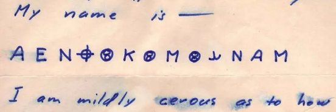
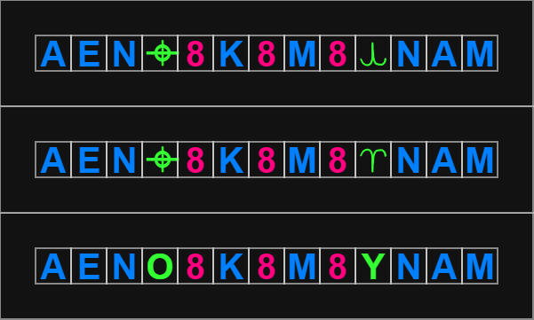
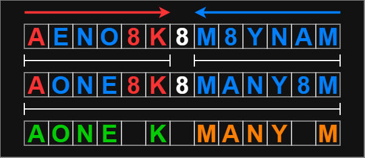
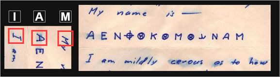
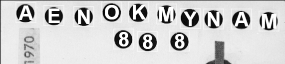
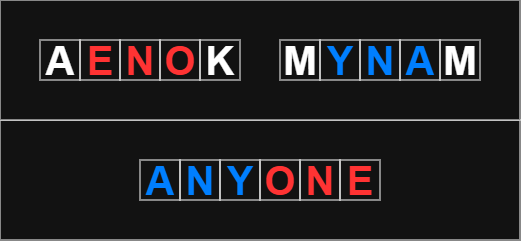
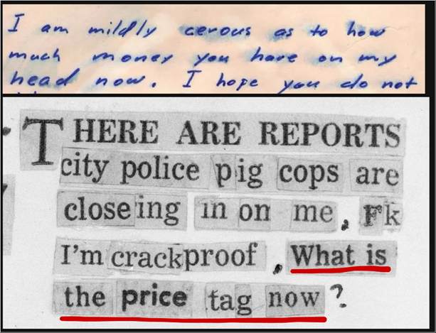

# Zodiacs Z13 letter, April 20, 1970.



Cipher transcription:
```text
A E N ⌖ ⑧ K ⑧ M ⑧ ۸ N A M
```

## **Foreword**

I know this theory will be heavily criticized, so I'll address what will likely be the main criticism first.

### **No real substitution**

I don't think any symbols in the cipher were actually completly replaced. 
Everything is as it appears, except that two letters were altered slightly.
The O was turned into a crosshair (**⌖**), and the Y was drawn as the Greek Y (upsilon **𝚼**) and then turned upside down.


I had this idea for a while already because i thought for such a short cipher even he must have realized that substitution is too much.
I was convinced that it had to say "MY NAME" and wrote a long unpublished hypothesis.
It was good that i didn't publish it, because when i thought more on it i realized how many arbitrary manipulations i needed for it.
Now i put more effort in, to avoid such problem but the idea that crosshair and the Anchor/upside-down-Upsilon 𝚼 are "O" and "Y" stuck, and that is what got me to this here.

#### Result:



```text
A E N [⌖] ⑧ K ⑧ M ⑧ [۸] N A M 
       ↓  flipping 𝚼  ↓ 
A E N [⌖] ⑧ K ⑧ M ⑧ [𝚼] N A M
       ↓              ↓ 
A E N [O] ⑧ K ⑧ M ⑧ [Y] N A M 
```

## **How I got here**

### Number Abbreviations

At first I didn't know what was going on in the cipher. But I thought it was slightly odd that, right after the cipher, he asks for a reward money for him ("I am mildly cerous as to how much money you have on my head now"). Then I realized that the "K" and "M" are serparated by the circled 8s from the rest of the cipher, they have to be somehow special.
I thought they might be initials for a long time, but taking the reward question now into account, it came to my mind that they could actually be abbreviations for large numbers, 
thousand and million to be specific.


If so, I thought there might be something more in the cipher that points to this, and there it was: ONE and MANY, an amount, written in reverse. 
Turned around, they give "A ONE K - MANY M", or intepreting this it would be "A one thousand. many million.". that would be an addition to the reward money question, but it would be missing the answer for "My name is---", so i looked further, and there actually seems to be a simple manipulation to get both. 



```text
A [E N O] ⑧ K ⑧ [M ⑧ Y N A M]
     ↓                 ↓ 
A [O N E] ⑧ K ⑧ [M A N Y ⑧ M]

[ A ONE K ] [ MANY M ]
```

## **What about the name?** 

### **Looking closer**

So this leaves the issue that the lead in to the cipher was "my name is--" but you would first suspect the cipher to answer the name question before it gets to the reward.
Well it actually does, there is something that seems more than a statistical anomaly. 
In the initial position of the cipher "One" is reversed, the interesting thing is that many contains the word "Any" which would also be reversed in the initial positions.
Not only that bad both contain an "N" in the middle, "N" is the only symmetric letter in the cipher (not counting the circled 8s).
Both start 1 letter away from the edge end, so also from the start of their respective sentences.
So since "One" and "Any" are reversed in thier initial position lets read them in the direction that makes them readable, Right to left.


You get "ANYONE", very interestingly, if you take the cipher and turn it 90° clockwise, the previous sentence , cipher, next senteces first letter create "I AM" with the cipher being the center.


|-|first letter| Sentence                 |
|-|------------|--------------------------|
|3|M|My Name is--                         |
|2|A|A E N ⌖ ⑧ K ⑧ M ⑧ ۸ N A M          |
|1|I|I am mildly cerous how much money... |


### **Coincidences?**

There is even something wilder. The only times the Zodiac asked for any reward money on him it was in the Z13 letter and the Punch-hole card. 
The Punch-hole card also has 13 punch-holes 10 in one row and 3 in the another row. 
If you fill the holes with the cipher it doesn't matter from which direction you the holes fill the circled 8s get fillter to the 3 hole row. 
Leaving all letters in the 10 hole row, in the Z13 letter he claimed to have killed 10 people. 



This makes the symmetry even stronger now N and with it the Trigrams sit exactly in the middle of both halves.

```text
A [E N O] K     M [Y N A] M
A [O N E] K     M [A N Y] M
```



Further more now you just need to mirror the trigrams to get "A ONE K - MANY MILLION".


What i hadn't mentioned above, because i only found it out later was that the Z13 letter was supposedly Zodiacs response to a reward that was put out for him.
$1000 dollar, is this coincidence or intentional? 

```QUOTE
On January 29th 1970, the Yellow Cab Company put up a thousand dollar reward for any information leading to the arrest of the Zodiac Killer.
In addition, the Teamsters Union which represents the Yellow Cab Company were reported in the San Francisco Chronicle to be considering offering a further reward on February 8th 1970 in the case of Paul Stine and Charles Jarman (another taxicab murder victim).
This news was likely what prompted the Zodiac Killer to open this communication with the words "I am mildly cerous as to how much money you have on my head now".

source: https://www.zodiacciphers.com/my-name-is-cipher.html
```

It may explain why he asked again in the Punch-hole card for the reward money even with "PRICE" and bold that time. 
First of all it is a hint to the solution for the Z13, but also it makes it pretty clear that he didn't like how little reward money they only put out.
So the "A one Thousand. Many Million?" is also a taunt.


