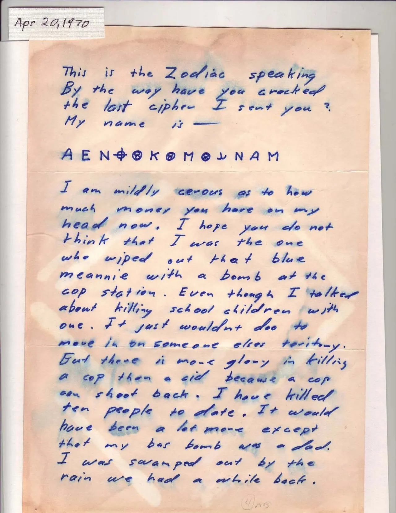
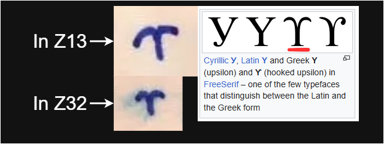
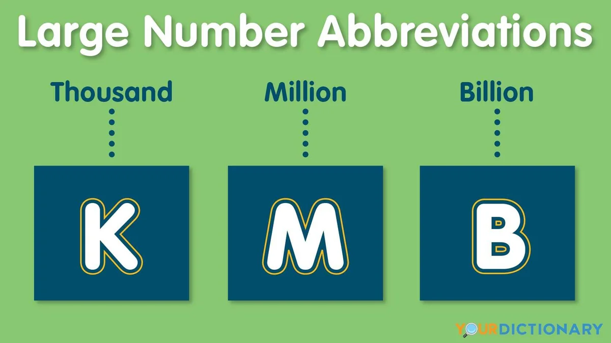
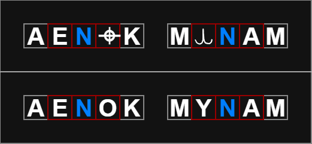
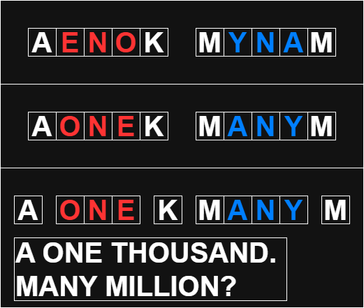
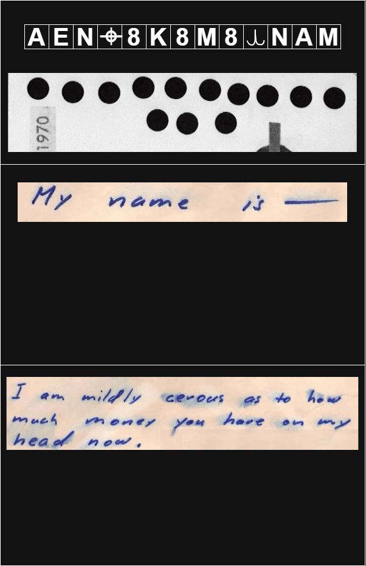

## **Foreword**

I know this theory will be heavily criticized, so I'll address the main criticism first.

### **No real substitution**

I don't think any symbols in the cipher were actually replaced. Everything is as it appears, except that two letters were altered slightly. The O was turned into a crosshair, and the Y was drawn as the Greek Y (upsilon) turned upside down.



---

### **How I got there**


At first I didn't know what was going on in the cipher. But I thought it was slightly odd that, right after the cipher, he asks for a reward money for him ("I am mildly cerous as to how much money you have on my head now"). Then I realized the K and M which are serperated with the circled 8s from the rest of the cipher in the middle, might be abbreviations for large numbers, 
thousand and million.



If so, I thought there might be an amount somewhere else in the cipher, and there it was: ONE and MANY, written in reverse. Turned around, they give "A one K, many M", so "A one thousand, many million". that would be an addition to the reward money question, but it would be missing the answer for the lead in to the cipher "My name is---", so i looked further.

### **The punch-hole card**

On the punch-hole card he also asks about the reward money ("What is the price tag now?"), and the card has 13 holes which is why I think the two are connected. If you fill them with the cipher, it doesn't matter which way you hold the card or from which end you fill the holes with the cipher. Because the rows are staggered, the circled 8s always end up on the other row. So the card seems to indicate that the circled 8s should be filtered out. They may have a meaning of their own, but maybe they're there to mark K and M as separate, possible abbreviations.


### **The N in the middle**

With the circled 8s removed as nulls, the cipher is 10 symbols long. You can split it into two halves of five, and an N sits exactly in the center of each half. Each N is the middle of a three-letter group: ENO in the first half and YNA in the second. Those are ONE and ANY in reverse.



### **Two readings**

First: Read the two groups backwards, from right to left, and you get ANY, then ONE: "anyone". That could be the answer to "My name is —". 


Second: Turn the two groups around so they read left to right, and the whole cipher becomes readable: "A ONE K, MANY M", one thousand, many million. That adds to his question about how much money is on his head.



So you get both an answer to "my name is …" and an addition to the reward question.

### **The $1,000**

What makes it more interesting is that the "one thousand" doesn't seem arbitrary. I only found this later: the Yellow Cab Company had put up a $1,000 reward in January 1970.

```QUOTE
On January 29th 1970, the Yellow Cab Company put up a thousand dollar reward for any information leading to the arrest of the Zodiac Killer.
In addition, the Teamsters Union which represents the Yellow Cab Company were reported in the San Francisco Chronicle to be considering offering a further reward on February circled 8th 1970 in the case of Paul Stine and Charles Jarman (another taxicab murder victim).
This news was likely what prompted the Zodiac Killer to open this communication with the words "I am mildly cerous as to how much money you have on my head now".

source: https://www.zodiacciphers.com/my-name-is-cipher.html
```

### Result
---


