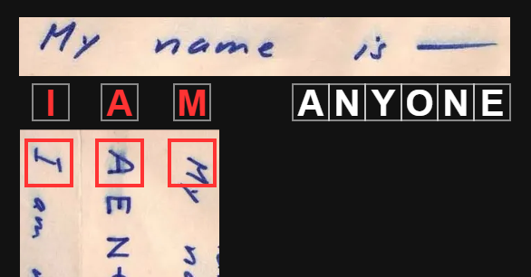
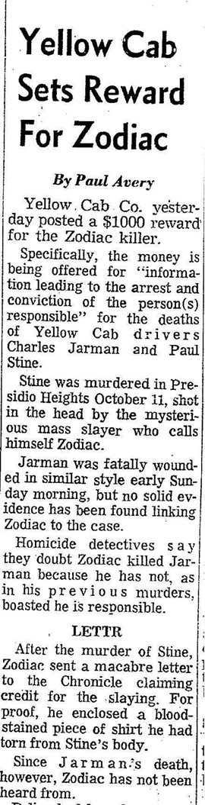
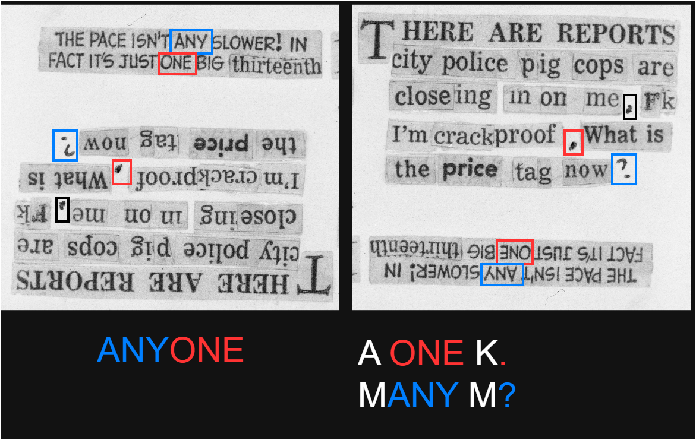
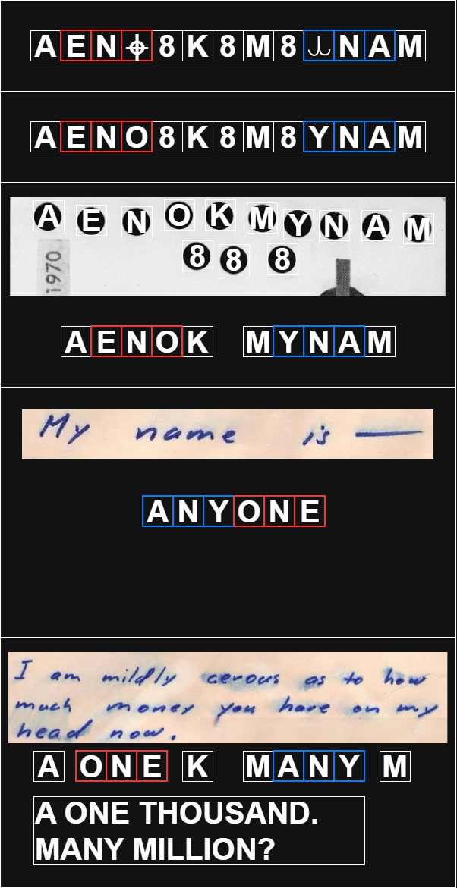

## **Foreword**

I know this theory will be heavily criticized, so I'll address the main criticism first.

### **No real substitution**

I don't think any symbols in the cipher were actually completly replaced. 
Everything is as it appears, except that two letters were altered slightly.
The O was turned into a crosshair, and the Y was drawn as the Greek Y (upsilon) turned upside down.


## **How I got there**


At first I didn't know what was going on in the cipher. But I thought it was slightly odd that, right after the cipher, he asks for a reward money for him ("I am mildly cerous as to how much money you have on my head now"). Then I realized that the K and M are serperated by the circled 8s from the rest of the cipher, they have to be somehow special, i thought they might be initials, but in conjuction with the reward question, it came to my mind that they could actually be abbreviations for large numbers, 
thousand and million.


If so, I thought there might be something more in the cipher that points to this, and there it was: ONE and MANY, an amount, written in reverse. 
Turned around, they give "A one K, M many", or intepreting this it would be "A one thousand. many million.". that would be an addition to the reward money question, but it would be missing the answer for "My name is---", so i looked further.

### **The punch-hole card**

On the punch-hole card he also asks about the reward money ("What is the price tag now?"), and the card has 13 holes it isn't unlikely that they are connected. 
If you fill the holes with the cipher, it doesn't matter which way you hold the card or from which end you fill the holes, because the rows are staggered, the circled 8s always end up in a different row. So the card seems to indicate that the circled 8s should be filtered out. They may also have a meaning of their own, but it seems they're primary there as spacers for K and M. Possibly to make us understand that they are special, in this case as large number abbreviations.


### **The N three-letter groups**

With the circled 8s treated as nulls/spacers, the cipher is 10 symbols long and would also fit with his claimed killcount of "ten" in the Z13 letter.
It has two equal halves. Each half has an N in the middle and every N is the middle of a three-letter group: ENO in the first half and YNA in the second. Those are ONE and ANY in reverse.


* **seperated only for visual clarity**


## **Two readings**

### First:
Read the two groups backwards, from right to left, and you get ANY, then ONE: "anyone". 
That could be the answer to "My name is —". 


Also cool is, if you turn the letter 90° clockwise, the first letter of the previous sentence ("M"), cipher ("A"), and next sentence ("I") form "I AM", together it would make "I AM ANYONE".



This might be coincidence.
I don't know if zodiac read homers odyssee, but what is interesting is that this has also a bit of a parallel with when odeysseus tricked the cyclops by calling himself "nobody".
```QUOTE
"Cyclops, you asked my noble name, and I will tell it; but do you give the stranger's gift, just as you promised. 
My name is Nobody.
Nobody I am called by mother, father, and by all my comrades."
```

### Second:
Turn the two groups around so they read left to right, and the whole cipher becomes readable: "A ONE K MANY M", one thousand, many million. You have two sentences if every half is it's own. That adds to his question about how much money is on his head.


So you get both an answer to "my name is---" and an addition to the reward question, by only reversing 2 trigrams.

### **The $1,000**

What makes it more interesting is that the "A one thousand" doesn't seem arbitrary. I only found this later: the Yellow Cab Company had put up a $1,000 reward in January 1970.
3 months before the Z13 letter.

```QUOTE
On January 29th 1970, the Yellow Cab Company put up a thousand dollar reward for any information leading to the arrest of the Zodiac Killer.
In addition, the Teamsters Union which represents the Yellow Cab Company were reported in the San Francisco Chronicle to be considering offering a further reward on February 8th 1970 in the case of Paul Stine and Charles Jarman (another taxicab murder victim).
This news was likely what prompted the Zodiac Killer to open this communication with the words "I am mildly cerous as to how much money you have on my head now".

source: https://www.zodiacciphers.com/my-name-is-cipher.html
```

The Questions "A one Thousand. many Million?" would hint that he thinks that $1,000 is far to low, and it hurt his ego, making it also a taunt.



### Punctuation:
Something that i may have to adress is that i added . and ? to "A ONE K. MANY M?".
There is also a hint to that in the punchhole card. he got his sentences from newpapers but for when he asked for a reward money again
".FK i'm crackproof. What is the price tag now?" 
He instead of using text from newspaper wrote the . and ? himself so maybe this is a hint, or just coincidence?



## Result

Either way, here are the end results as picture and animation.

### Picture:



### Animation:


